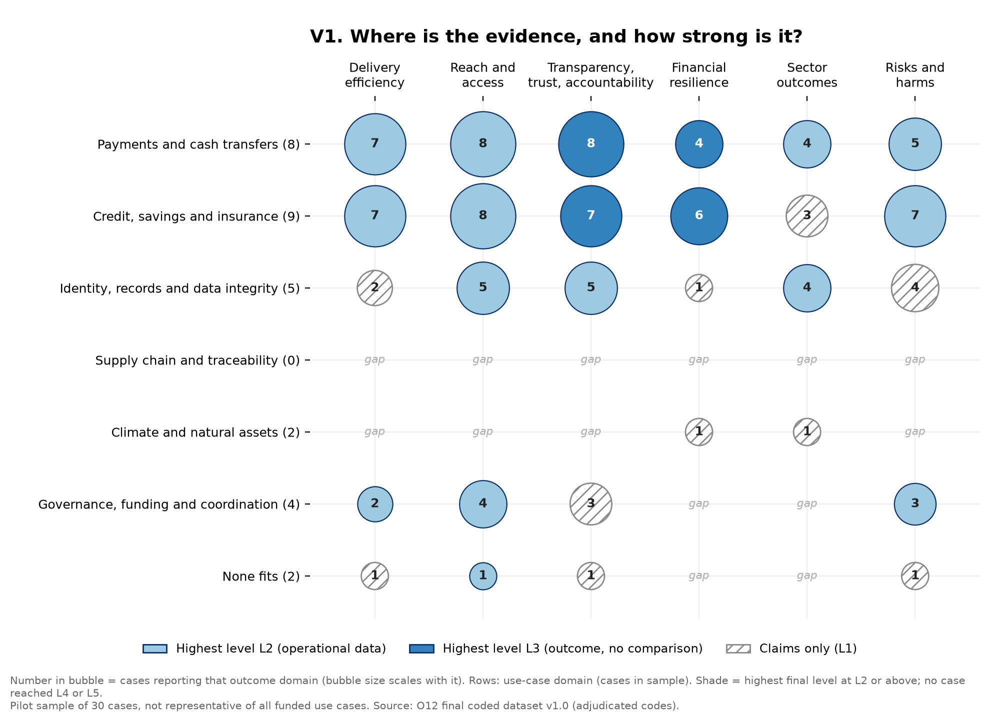
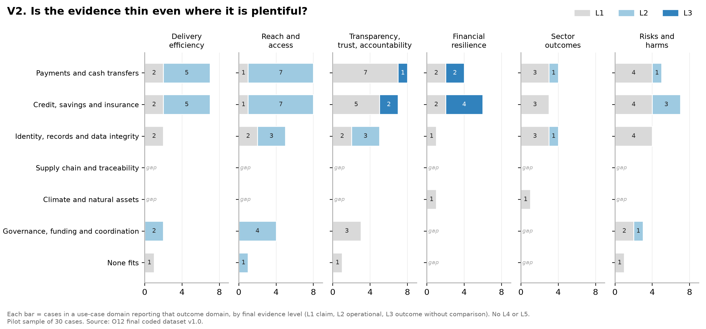
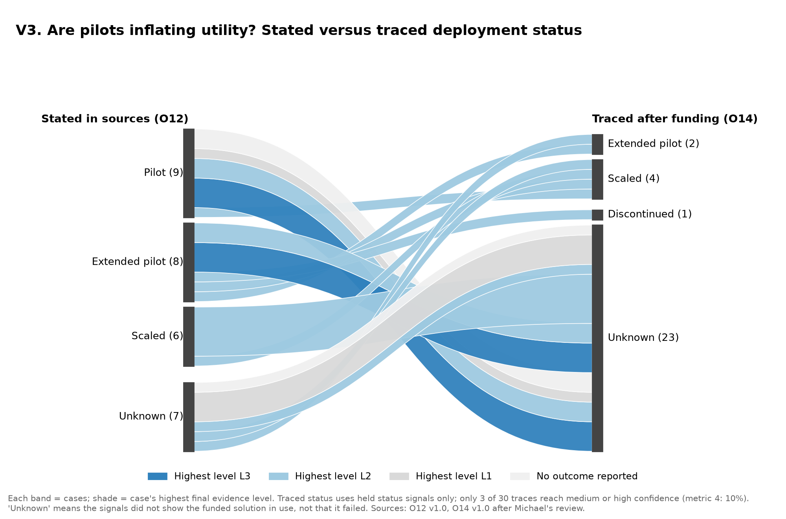
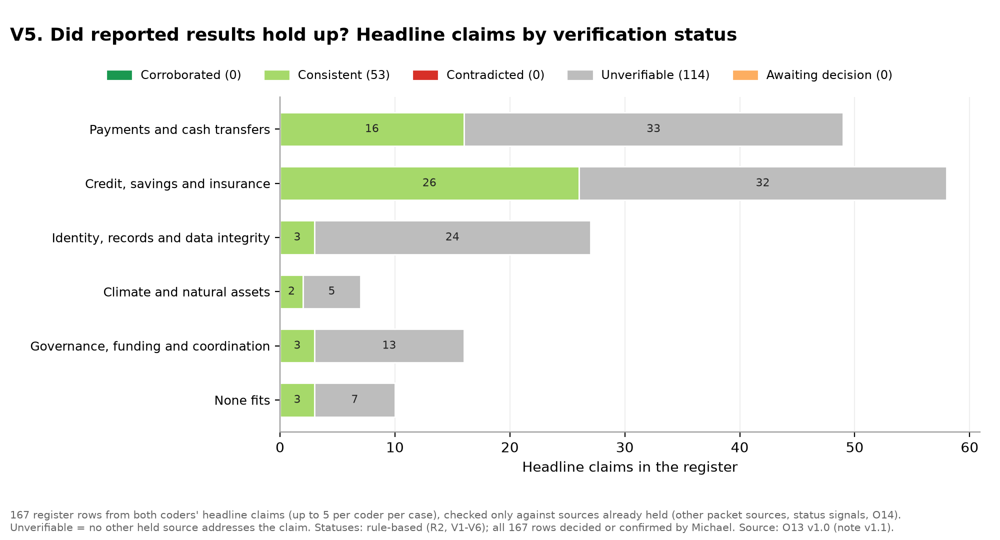

# Visuals

The visual pack (O15), published at Gate 4 on 19 October 2026. Static images for the 30 pilot cases, each with its data table.

| Visual | What it shows | Question it answers | Pilot | Status |
|---|---|---|---|---|
| V1 Core EGM bubble matrix | Domain by outcome; size = number of use cases; shade = highest evidence level; gaps labelled | Where is the evidence and how strong is it? | Yes | [Image](../outputs/10_Analysis_and_Visuals/V1_evidence_matrix_v1.0.png) · [Data](../outputs/10_Analysis_and_Visuals/V1_V2_cell_table_v1.0.csv) · [Interactive version](../map/index.md) |
| V2 Evidence-depth bars | Stacked bar of cases at each level, per cell | Is the evidence thin even where it is plentiful? | Yes | [Image](../outputs/10_Analysis_and_Visuals/V2_evidence_depth_v1.0.png) · [Data](../outputs/10_Analysis_and_Visuals/V1_V2_cell_table_v1.0.csv) |
| V3 Deployment pathway | Flow from pilot to extended, scaled, handed over or discontinued, shaded by evidence level | Are pilots inflating utility? | Yes | [Image](../outputs/10_Analysis_and_Visuals/V3_deployment_pathway_v1.0.png) · [Data](../outputs/10_Analysis_and_Visuals/V3_pathway_table_v1.0.csv) |
| V4 Function by domain heatmap | Blockchain function against use-case domain | Which ledger features are used where? | Optional | Not yet produced |
| V5 Claims check | Headline claims by verification status and domain | Did reported results hold up? | Yes | [Image](../outputs/10_Analysis_and_Visuals/V5_claims_check_v1.0.png) · [Data](../outputs/10_Analysis_and_Visuals/V5_claims_table_v1.0.csv) |
| V6 Funding-opportunity matrix | Cells coloured by gap type | Where would new grants add the most evidence? | Optional | Not yet produced |
| V7 Filtered small multiples | V1 by portfolio, region, population or producer | Does the picture change by slice? | Full scope | – |

## V1 Where is the evidence, and how strong is it?

## V2 Is the evidence thin even where it is plentiful?

## V3 Are pilots inflating utility?

'Unknown' means the held status signals did not show the funded solution in use, not that it failed.

## V5 Did reported results hold up?

