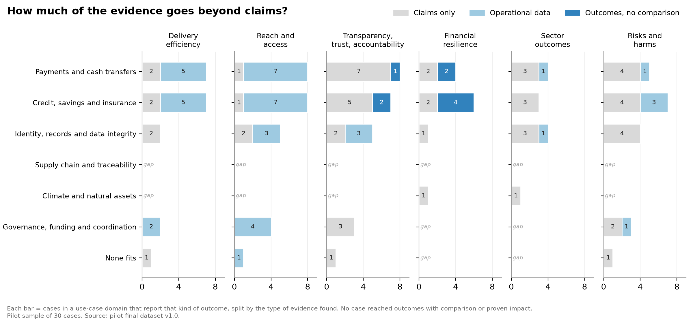
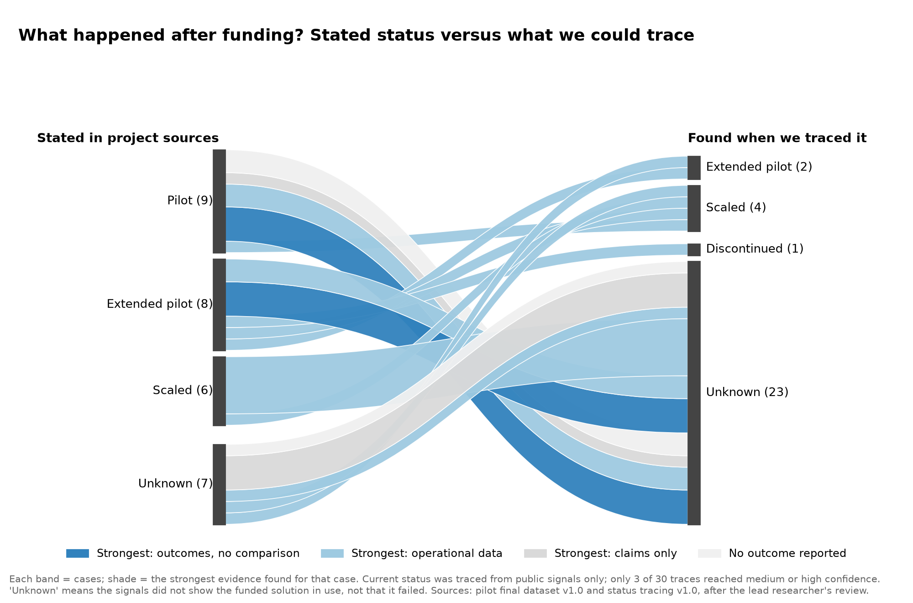
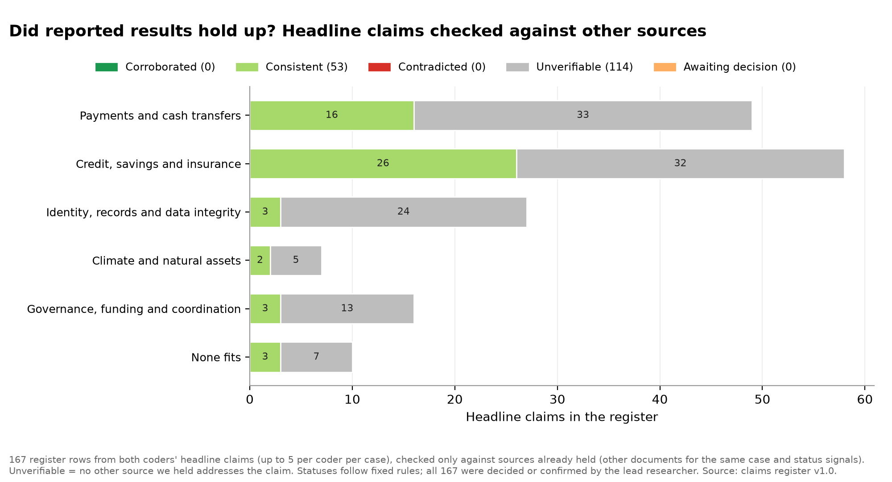

# Visuals

Four charts that summarise the evidence for the 30 pilot projects. Each chart answers one question. All of them use the same colours as the [interactive map](../map/index.md): light for weaker evidence, dark for stronger.

## Three things to know

- **Most evidence is claims or activity data.** Only 9 of 113 project-outcome records report outcomes for participants, and none of those has a comparison group.
- **We could confirm what happened after funding for only a few projects.** For 23 of 30, public sources did not show whether the project is still running. That does not mean it failed.
- **No reported result was contradicted, but most could not be checked.** Of 167 headline claims, 53 matched another source, none were contradicted and 114 could not be checked against any other source.

## The evidence spectrum

Every chart sorts evidence into the same five steps, from weakest to strongest:

  
1. Claims onlyThe project describes what it does and why it should work. There are no data on results.Strongest evidence for 4 cases

  
2. Operational dataData on activity, such as payments made, users reached or processing times. It shows the system runs, not whether people are better off.Strongest evidence for 17 cases

  
3. Outcomes, no comparisonChanges reported for participants, such as income or savings. With nothing to compare against, we cannot tell whether the project caused them.Strongest evidence for 6 cases

  
4. Outcomes with comparisonParticipants compared with a similar group, or with a non-blockchain alternative. This starts to show what the project added.No pilot cases

  
5. Proven impactA randomised trial or strong quasi-experimental study estimates the effect, ideally done independently.No pilot cases

Weaker: tells you what was promised or doneStronger: tells you what difference it made

The spectrum describes the type of evidence found in public sources, not the quality of a project. The protocol and data files use the codes L1 to L5 for these steps; see [methods](../methods/index.md#evidence-spectrum).

## Where is there evidence, and how strong is it?

Each bubble is one type of use (row) reporting one type of outcome (column). The number is how many projects report it, and the shade is the strongest evidence found. "Gap" means no evidence.

[Explore the interactive version](../map/index.md) · [Download the data](../outputs/10_Analysis_and_Visuals/V1_V2_cell_table_v1.0.csv)

## How much of the evidence goes beyond claims?

The same cells, with each bar split by type of evidence. Where there is evidence, much of it is still claims only, especially for transparency and for risks and harms.

[Download the data](../outputs/10_Analysis_and_Visuals/V1_V2_cell_table_v1.0.csv)

## What happened after funding?

On the left is the status each project's own sources stated. On the right is what we could confirm when we traced it from public signals. The shade shows the strongest evidence for each project.

"Unknown" means the public signals did not show the funded solution in use. It does not mean the project failed. [Download the data](../outputs/10_Analysis_and_Visuals/V3_pathway_table_v1.0.csv)

## Did reported results hold up?

Each project's headline claims were checked against the other documents we held for that project.

[Download the data](../outputs/10_Analysis_and_Visuals/V5_claims_table_v1.0.csv)

??? note "Technical notes"
    These images are version 1.1 (19 October 2026). They show the same data as version 1.0, with plain names in place of the level codes. Version 1.0 images are kept in the [outputs folder](../outputs/index.md). The charts draw on the final coded dataset (O12), status tracing (O14) and claims register (O13).

    | Chart | Protocol name | Status |
    |---|---|---|
    | Where is there evidence? | V1 core bubble matrix | Published |
    | How much goes beyond claims? | V2 evidence-depth bars | Published |
    | What happened after funding? | V3 deployment pathway | Published |
    | Which ledger features are used where? | V4 function-by-domain heatmap | Optional; not produced |
    | Did reported results hold up? | V5 claims check | Published |
    | Where would new grants add most evidence? | V6 funding-opportunity matrix | Optional; not produced |
    | Does the picture change by slice? | V7 filtered small multiples | Full study |
